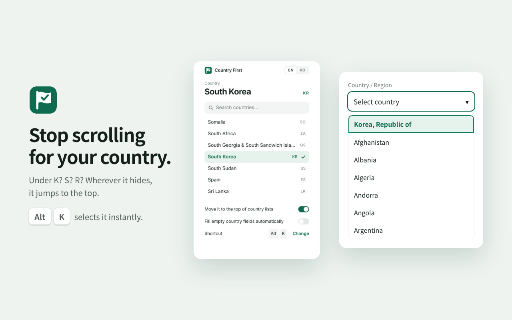

# Country First · 국가 선택기

Stop scrolling for your country. Set it once; it jumps to the top of every country picker on any site, and **Alt+K** selects it instantly.

## What it does

- Finds your country in native `<select>` lists, ARIA listboxes, plain `div` lists, virtual-scroll lists, searchable comboboxes, phone-code pickers, flag-only lists, shadow DOM components and iframes.
- Reads country names in 80+ languages, plus official, short and abbreviated forms (`Korea, Republic of`, `S. Korea`, `Corée du Sud`, `大韓民國`, `ROK`, `+82`).
- Does not pick a look-alike. `Korea (North)`, `Congo (Kinshasa)`, `Guinea-Bissau`, `Sudan (South)` and `Estados Unidos Mexicanos` are recognized as other countries and skipped.
- With nothing focused, Alt+K fills every empty country field on the page.
- Collects no data and makes no network requests.

## Install

Chrome Web Store listing: in review.

To load it from source, open `chrome://extensions`, turn on Developer mode, choose **Load unpacked** and select this folder.

## How matching works

Every option's text is normalized (accents, punctuation, dial codes and flag emoji removed) and compared against the names of the chosen country. A name that also belongs to another country is never used. When only part of the text matches, such as `Korea` inside `Korea (North)`, the rest of the line is checked for words that mark a different country, and the line is skipped if any are found. Aliases such as `England` are weak: they are used only when no stronger name for the country is in the list.

## Third-party data

Country names are derived from iso-codes and pycountry (LGPL-2.1), and calling codes from libphonenumber (Apache-2.0). See [NOTICE.md](NOTICE.md).
