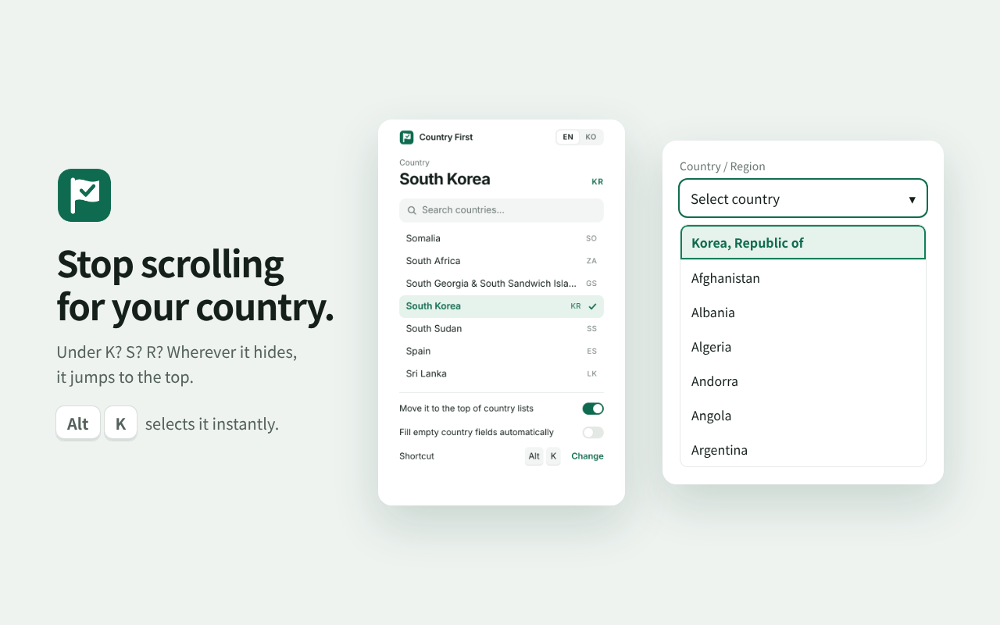

# Country First · 국가 선택기

Signing up on a foreign site, and South Korea is hiding under **R** as `Korea, Republic of`, right next to North Korea? Or the list starts at Afghanistan and you scroll for ten seconds every time? Set your country once, and Country First moves it to the top of every country picker on any site. **Alt+K** selects it instantly.

**[Install from the Chrome Web Store](https://chromewebstore.google.com/detail/coonojgeinmmeibcgcnceaogmhechodk)**

## What it does

- Finds your country in native `<select>` lists, ARIA listboxes, plain `div` lists, virtual-scroll lists, searchable comboboxes, phone-code pickers, flag-only lists, shadow DOM components and iframes.
- Reads country names in 80+ languages, plus official, short and abbreviated forms (`Korea, Republic of`, `S. Korea`, `Corée du Sud`, `大韓民國`, `ROK`, `+82`).
- Does not pick a look-alike. `Korea (North)`, `Congo (Kinshasa)`, `Guinea-Bissau`, `Sudan (South)` and `Estados Unidos Mexicanos` are recognized as other countries and skipped.
- With nothing focused, Alt+K fills every empty country field on the page.
- Collects no data and makes no network requests. See the [privacy policy](PRIVACY.md).

## 한국어 안내

해외 사이트에서 회원가입하거나 배송지를 적을 때, 국가 목록에서 대한민국을 찾느라 한참 스크롤해 본 적 있을 거예요. 어떤 사이트는 `South Korea`라 S에 두고, 어떤 사이트는 `Korea, Republic of`라 R에 두고, 바로 옆에는 북한이 붙어 있죠.

국가 선택기는 한 번 정해 둔 나라를 어느 사이트에서든 국가 목록 맨 위로 올려 줍니다. 입력 칸에서 **Alt+K**를 누르면 바로 골라 주고, 아무 칸도 선택하지 않은 채 누르면 페이지의 빈 국가 칸을 한꺼번에 채워요. `대한민국`, `한국`, `Korea, Republic of`, `ROK`, `+82`처럼 여러 표기를 알아보고, 북한처럼 이름이 비슷한 다른 나라는 고르지 않습니다. 한국어 크롬에서는 처음부터 대한민국으로 맞춰져 있어요.

데이터는 수집하지 않고 외부와 통신하지도 않습니다. 설정은 내 크롬 계정의 동기화 저장소에만 남아요.

**[크롬 웹 스토어에서 설치하기](https://chromewebstore.google.com/detail/coonojgeinmmeibcgcnceaogmhechodk?hl=ko)**

## FAQ

**Why is South Korea listed under R?**
Many sites take their country list straight from ISO 3166, where the English short name is `Korea, Republic of`. Sorted alphabetically, it lands between Qatar and Romania. Country First matches that form along with every other common spelling, so the list order no longer matters.

**Does it work for countries other than Korea?**
Yes. Pick any country or territory in the popup. Korea gets extra attention because its names are unusually scattered across lists, but the same matching runs for every country.

**Will it ever select North Korea by mistake?**
No. A name that also belongs to another country is never used, and a partial match is dropped when the rest of the line points to a different country.

**Can I change the shortcut?**
Yes. Open `chrome://extensions/shortcuts`, or click **Change** in the popup.

## Install from source

Open `chrome://extensions`, turn on Developer mode, choose **Load unpacked** and select this folder.

`build.sh` produces the minified package that is uploaded to the Chrome Web Store. It needs [terser](https://terser.org/).

## How matching works

Every option's text is normalized (accents, punctuation, dial codes and flag emoji removed) and compared against the names of the chosen country. A name that also belongs to another country is never used. When only part of the text matches, such as `Korea` inside `Korea (North)`, the rest of the line is checked for words that mark a different country, and the line is skipped if any are found. Aliases such as `England` are weak: they are used only when no stronger name for the country is in the list.

## Third-party data

Country names are derived from iso-codes and pycountry (LGPL-2.1), and calling codes from libphonenumber (Apache-2.0). See [NOTICE.md](NOTICE.md).
